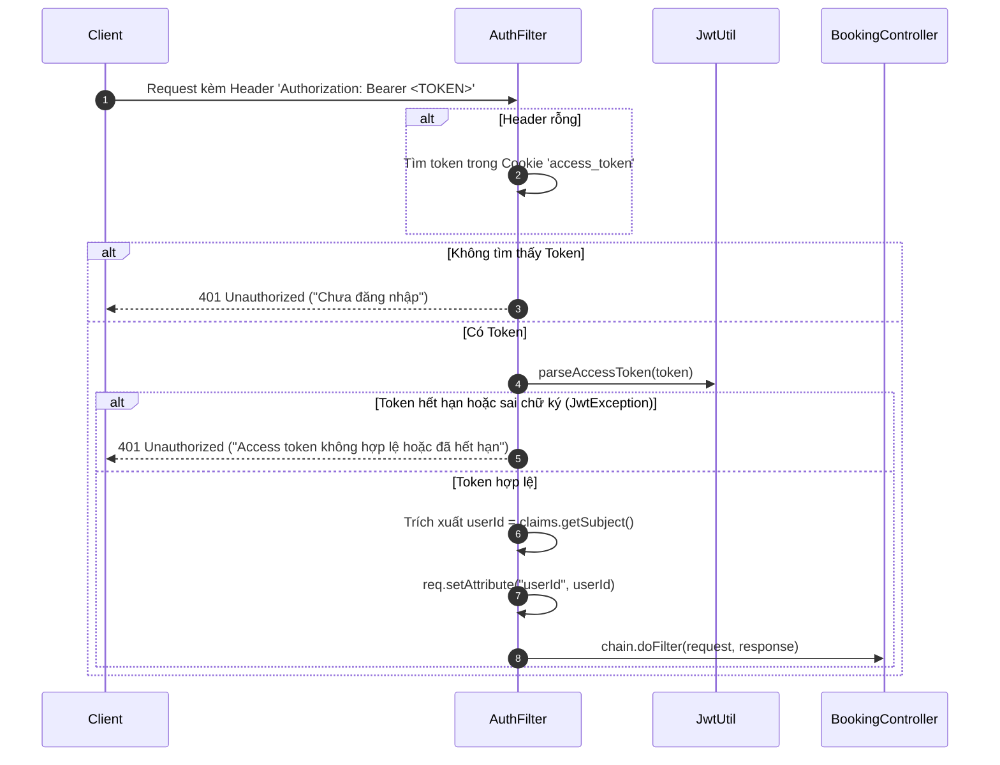

# TÀI LIỆU HƯỚNG DẪN LUỒNG NGHIỆP VỤ BACKEND: MODULE BOOKING & XÁC THỰC JWT

Tài liệu này mô tả chi tiết toàn bộ kiến trúc, cơ chế xác thực JWT, và luồng nghiệp vụ của **7 routes chính** trong Module Đặt vé (**Booking**) của hệ thống rạp chiếu phim **Cinema API**.

---

## MỤC LỤC
1. [Kiến trúc tổng thể (Architecture)](#1-kiến-trúc-tổng-thể-architecture)
2. [Cơ chế xác thực người dùng qua JWT (JWT Authentication)](#2-cơ-chế-xác-thực-người-dùng-qua-jwt-jwt-authentication)
3. [Chi tiết luồng nghiệp vụ 7 Routes Booking](#3-chi-tiết-luồng-nghiệp-vụ-7-routes-booking)
   - [Route 1: POST /api/bookings (Tạo đơn & Giữ ghế)](#route-1-post-apibookings-tạo-đơn-đặt-vé--giữ-ghế)
   - [Route 2: GET /api/bookings/{id} (Xem chi tiết & Tự động quét hết hạn)](#route-2-get-apibookingsid-xem-chi-tiết-đơn--tự-động-quét-hết-hạn)
   - [Route 3: PUT /api/bookings/{id}/items (Cập nhật bắp nước F&B)](#route-3-put-apibookingsiditems-cập-nhật-bắp-nước-fb)
   - [Route 4: PUT /api/bookings/{id}/voucher (Áp dụng Voucher giảm giá)](#route-4-put-apibookingsidvoucher-áp-dụng-voucher-giảm-giá)
   - [Route 5: POST /api/bookings/{id}/cancel (Hủy đơn & Nhả ghế)](#route-5-post-apibookingsidcancel-hủy-đơn-đặt-vé--nhả-ghế)
   - [Route 6: POST /api/bookings/{id}/refund (Yêu cầu hoàn tiền vé)](#route-6-post-apibookingsidrefund-yêu-cầu-hoàn-tiền-vé)
   - [Route 7: GET /api/bookings/{id}/refund (Xem chi tiết hoàn tiền)](#route-7-get-apibookingsidrefund-xem-chi-tiết-tiến-trình-hoàn-tiền)
4. [Cầu nối thanh toán & Xuất vé (Payment & Fulfillment Bridge)](#4-cầu-nối-thanh-toán--xuất-vé-payment--fulfillment-bridge)
5. [Bảng mã lỗi HTTP Status Code chuẩn (Error Matrix)](#5-bảng-mã-lỗi-http-status-code-chuẩn-error-matrix)

---

## 1. KIẾN TRÚC TỔNG THỂ (ARCHITECTURE)

Hệ thống backend được xây dựng trên nền tảng **Java 21**, **Jakarta Servlet 6.1**, **Hibernate JPA 6.5.2**, và **PostgreSQL** theo mô hình 4 tầng phân tách trách nhiệm rõ ràng:

```
[HTTP Request từ Client]
        │  (Header: Authorization: Bearer <JWT_TOKEN>)
        ▼
┌─────────────────────────────────────────────────────────────────┐
│ 1. TẦNG BẢO MẬT & ĐIỀU HƯỚNG (Filter Layer)                     │
│    • ApiPrefixFilter: Chuẩn hóa tiền tố đường dẫn /api/*        │
│    • AuthFilter: Chặn request, giải mã JWT, lấy userId          │
└───────────────────────────────┬─────────────────────────────────┘
                                │
                                ▼
┌─────────────────────────────────────────────────────────────────┐
│ 2. TẦNG ĐIỀU KHIỂN (Controller Layer - BaseServlet)             │
│    • BookingController.java                                     │
│      - Định tuyến 7 endpoint theo URL segments                  │
│      - Đọc JSON Request Body -> Map vào DTO                     │
│      - Lấy userId từ HttpServletRequest Attribute               │
│      - Trả về JSON ApiResponse chuẩn (200, 201, 400, 409...)   │
└───────────────────────────────┬─────────────────────────────────┘
                                │
                                ▼
┌─────────────────────────────────────────────────────────────────┐
│ 3. TẦNG NGHIỆP VỤ (Service Layer)                              │
│    • BookingService.java                                        │
│      - Kiểm tra tính hợp lệ dữ liệu đầu vào (DTO validation)    │
│      - Điều phối luồng và quản lý các ngoại lệ ApiException     │
└───────────────────────────────┬─────────────────────────────────┘
                                │
                                ▼
┌─────────────────────────────────────────────────────────────────┐
│ 4. TẦNG TRUY XUẤT DỮ LIỆU (DAO Layer & Database Transactions)   │
│    • BookingDAO.java & RefundDAO.java                           │
│      - Mở Transaction (EntityManager.getTransaction().begin()) │
│      - Khóa ghế chống trùng (Locking Mechanism / Version check) │
│      - Tính toán giá vé, phụ thu ghế VIP, F&B, voucher discount │
│      - Commit / Rollback giao dịch                              │
└─────────────────────────────────────────────────────────────────┘
```

### Các bảng cơ sở dữ liệu cốt lõi:
* `cinema.bookings`: Đơn hàng (`booking_id`, `user_id`, `show_time_id`, `total_amount`, `discount_amount`, `final_amount`, `voucher_id`, `status`, `hold_expires_at`, `version`).
* `cinema.booking_items`: Chi tiết món F&B bắp nước trong đơn (`booking_id`, `product_id`, `quantity`, `price`).
* `cinema.show_time_seats`: Ghế của từng suất chiếu (`show_time_seat_id`, `seat_id`, `show_time_id`, `status`, `booking_id`, `hold_expiration_at`, `version`).
* `cinema.tickets`: Vé xem phim phục vụ soát vé vào rạp (`ticket_id`, `booking_id`, `show_time_seat_id`, `ticket_code`, `status`).
* `cinema.payments`: Lịch sử các giao dịch thanh toán (`payment_id`, `booking_id`, `amount`, `method`, `status`).
* `cinema.vouchers` & `cinema.user_vouchers`: Thông tin và lượt dùng voucher của người dùng.
* `cinema.refunds`: Yêu cầu hoàn tiền (`refund_id`, `booking_id`, `payment_id`, `amount`, `reason`, `status`).

---

## 2. CƠ CHẾ XÁC THỰC NGƯỜI DÙNG QUA JWT (JWT AUTHENTICATION)

Toàn bộ các routes trong module Booking đều yêu cầu người dùng phải đăng nhập để bảo vệ thông tin đặt vé và tài sản cá nhân.

### 2.1 Cấu trúc & Thuật toán mã hóa Token
* **Thuật toán chữ ký**: `HMAC-SHA256` (HS256) sử dụng khóa bí mật cấu hình qua biến môi trường `JWT_SECRET`.
* **Thời hạn sống của Token**:
  * **Access Token**: `15 phút` (900.000 ms) - dùng để gọi API hàng ngày.
  * **Refresh Token**: `7 ngày` - lưu dưới dạng HttpOnly Cookie để cấp mới Access Token.
* **Payload của Access Token**:
  * `sub` (Subject): `userId` của người dùng (ví dụ: `"8"`).
  * `iat` (Issued At): Thời điểm tạo token.
  * `exp` (Expiration): Thời điểm token hết hạn.

```java
// Mã nguồn trong JwtUtil.java
public static String generateAccessToken(long userId) {
    Date now = new Date();
    return Jwts.builder()
            .subject(String.valueOf(userId))
            .issuedAt(now)
            .expiration(new Date(now.getTime() + ACCESS_TTL_MS))
            .signWith(KEY)
            .compact();
}
```

### 2.2 Quy trình xác thực trong `AuthFilter.java`
Khi một request gửi đến các đường dẫn `/bookings` hoặc `/bookings/*`, chu trình sau sẽ diễn ra:



### 2.3 Cách Controller lấy `userId` an toàn (`BaseServlet.java`)
Trong `BookingController.java`, không bao giờ nhận `userId` từ body hay query param của client (tránh giả mạo danh tính), mà lấy thông qua phương thức kế thừa từ `BaseServlet`:

```java
// Trong BaseServlet.java:
protected long getAuthenticatedUserId(HttpServletRequest req) {
    Object attr = req.getAttribute("userId");
    if (attr instanceof Number n) return n.longValue();
    throw AuthException.unauthorized();
}

// Trong BookingController.java:
long userId = getAuthenticatedUserId(req); // Luôn đảm bảo userId đã được xác thực
```

---

## 3. CHI TIẾT LUỒNG NGHIỆP VỤ 7 ROUTES BOOKING

---

### Route 1: POST /api/bookings (Tạo đơn đặt vé & Giữ ghế)

* **Mục tiêu**: Khách hàng chọn danh sách ghế và các combo bắp nước đi kèm để tạo đơn hàng mới. Ghế sẽ được khóa giữ chỗ tạm thời trong **10 phút** để tránh người khác đặt trùng.
* **Quyền hạn**: Đã đăng nhập (`AuthFilter`).

#### Luồng xử lý nghiệp vụ:
1. **Validate tham số**: Kiểm tra `showTimeId > 0`, danh sách `seatIds` không được rỗng (tối đa 8 ghế/lần đặt), số lượng món F&B $\ge 0$.
2. **Kiểm tra suất chiếu**: Suất chiếu phải tồn tại, trạng thái phòng hoạt động, và giờ bắt đầu suất chiếu phải ở tương lai (`startTime > now`).
3. **Kiểm tra trạng thái ghế & Khóa chống tranh chấp (Pessimistic/Optimistic Lock)**:
   * Truy vấn bảng `cinema.show_time_seats` cho các ghế được chọn.
   * Nếu ghế đã có trạng thái `BOOKED` $\rightarrow$ Ném lỗi `409 Conflict` (*"Ghế đã có người mua"*).
   * Nếu ghế đang ở trạng thái `SELECTED` và thời hạn `hold_expiration_at > now` $\rightarrow$ Ném lỗi `409 Conflict` (*"Ghế đang được người khác giữ chỗ"*).
4. **Giữ ghế (Seat Holding)**:
   * Cập nhật trạng thái từng ghế sang `SELECTED`.
   * Gán `hold_expiration_at = now + 10 phút`.
   * Tăng `version = version + 1`.
5. **Tính toán tổng tiền**:
   * Tiền ghế: Tính theo giá cơ bản của suất chiếu + phụ thu loại ghế (Ghế VIP +15.000đ, Ghế Đôi Sweetbox...).
   * Tiền bắp nước (F&B): Lấy giá từ bảng `cinema.products` $\times$ số lượng.
   * Tổng tiền = Tiền ghế + Tiền F&B.
6. **Lưu bản ghi `Booking` & `BookingItems`**:
   * Tạo bản ghi `cinema.bookings` với `status = 'PENDING'`, `hold_expires_at = now + 10 phút`.
   * Lưu các món bắp nước vào `cinema.booking_items`.
   * Gán `booking_id` vào các ghế trong `cinema.show_time_seats`.
   * Commit Transaction và trả về `201 Created`.

* **Request Body mẫu**:
  ```json
  {
    "showTimeId": 12,
    "seatIds": [101, 102],
    "productItems": [
      { "productId": 1, "quantity": 2 }
    ]
  }
  ```
* **Response `201 Created` mẫu**:
  ```json
  {
    "success": true,
    "data": {
      "bookingId": 28,
      "totalAmount": 210000,
      "holdExpiresAt": "2026-10-12T17:15:00",
      "status": "PENDING"
    }
  }
  ```

---

### Route 2: GET /api/bookings/{id} (Xem chi tiết đơn & Tự động quét hết hạn)

* **Mục tiêu**: Lấy toàn bộ thông tin đơn vé (tên phim, suất chiếu, phòng, danh sách mã ghế, bắp nước, voucher, tiền thanh toán).
* **Cơ chế tự động đặc biệt (Auto-Expire)**: Khi người dùng xem chi tiết đơn hàng đang ở trạng thái `PENDING`, nếu thời gian hiện tại đã vượt quá `hold_expires_at`, hệ thống sẽ **tự động giải phóng ghế** và chuyển đơn sang `EXPIRED`.

#### Luồng xử lý nghiệp vụ:
1. **Kiểm tra quyền sở hữu**: Tìm đơn theo `bookingId`. Nếu không thấy $\rightarrow$ `404 Not Found`. Nếu `booking.userId != currentUserId` $\rightarrow$ `403 Forbidden` (*"Bạn không có quyền xem đơn hàng của người khác"*).
2. **Kiểm tra hết hạn giữ chỗ (Auto-Expire Logic)**:
   * Nếu `booking.status == 'PENDING'` VÀ `booking.holdExpiresAt < now`:
     * Tự động cập nhật `cinema.show_time_seats`: Đổi `status = 'AVAILABLE'`, xóa `booking_id = NULL`, xóa `hold_expiration_at = NULL`.
     * Cập nhật `booking.status = 'EXPIRED'`.
     * Lưu vào Database.
3. **Đóng gói dữ liệu trả về**: Lấy tên phim, poster, phòng chiếu, tên ghế (`H08`, `H09`), chi tiết bắp nước, voucher đã áp dụng. Trả về `200 OK`.

* **Response `200 OK` mẫu**:
  ```json
  {
    "success": true,
    "data": {
      "bookingId": 28,
      "status": "PENDING",
      "totalAmount": 210000,
      "finalAmount": 210000,
      "movieTitle": "Dune: Hành Tinh Cát - Phần 2",
      "roomName": "Phòng Chiếu 1",
      "startTime": "2026-10-12T19:30:00",
      "seats": ["H08", "H09"],
      "items": [
        { "productName": "Bắp Rang Bơ Phô Mai", "quantity": 2, "price": 45000 }
      ],
      "holdExpiresAt": "2026-10-12T17:15:00"
    }
  }
  ```

---

### Route 3: PUT /api/bookings/{id}/items (Cập nhật bắp nước F&B)

* **Mục tiêu**: Cho phép khách hàng thêm, bớt hoặc đổi các món bắp nước trước khi thanh toán.
* **Điều kiện bắt buộc**: Đơn hàng phải đang ở trạng thái `PENDING` và ghế vẫn còn trong thời gian giữ chỗ.

#### Luồng xử lý nghiệp vụ:
1. **Kiểm tra đơn hàng**:
   * Đơn phải tồn tại và thuộc về `userId`.
   * `booking.status` phải là `PENDING`. Nếu đơn đã `CONFIRMED`, `CANCELLED` hoặc `EXPIRED` $\rightarrow$ Ném `409 Conflict`.
   * Kiểm tra hạn giữ ghế: Nếu `holdExpiresAt < now` $\rightarrow$ Ném lỗi `410 Gone` (*"Đã hết thời gian giữ ghế"*).
2. **Cập nhật danh sách món**:
   * Xóa toàn bộ các bản ghi `cinema.booking_items` cũ của đơn hàng này.
   * Thêm lại các món mới từ request (kiểm tra `productId` phải tồn tại trong `cinema.products`).
3. **Tính lại tổng tiền**:
   * Tiền F&B mới = $\sum (\text{giá món} \times \text{số lượng})$.
   * Cập nhật `booking.totalAmount = Tiền ghế + Tiền F&B mới`.
   * Nếu đơn đang áp dụng voucher, tự động tính lại số tiền giảm `discountAmount` và `finalAmount`.
4. Commit và trả về `200 OK`.

* **Request Body mẫu**:
  ```json
  {
    "items": [
      { "productId": 1, "quantity": 1 },
      { "productId": 2, "quantity": 2 }
    ]
  }
  ```

---

### Route 4: PUT /api/bookings/{id}/voucher (Áp dụng Voucher giảm giá)

* **Mục tiêu**: Áp dụng mã giảm giá khuyến mãi vào đơn hàng trước khi thanh toán.
* **Điều kiện bắt buộc**: Đơn hàng `PENDING`, còn hạn giữ ghế, voucher còn lượt dùng và đạt giá trị tối thiểu.

#### Luồng xử lý nghiệp vụ:
1. **Kiểm tra đơn hàng**: Đơn phải là `PENDING` và còn hạn giữ chỗ.
2. **Kiểm tra tính hợp lệ của Voucher**:
   * Tìm voucher theo mã `code` (không phân biệt chữ hoa/thường).
   * Trạng thái voucher phải là `ACTIVE`.
   * Ngày hiện tại phải nằm trong khoảng `startDate` đến `endDate`.
   * Kiểm tra số lượng: Nếu `usedCount >= quantity` $\rightarrow$ Ném `422 Unprocessable` (*"Voucher đã hết lượt sử dụng"*).
   * Kiểm tra đơn hàng tối thiểu: `totalAmount` của đơn phải $\ge$ `minSpend` của voucher.
3. **Tính số tiền giảm trừ (`discountAmount`)**:
   * Nếu giảm theo phần trăm: `discountAmount = totalAmount * discountPercent / 100`. (Nếu vượt quá `maxDiscount` thì chặn ở mức trần `maxDiscount`).
   * Nếu giảm theo số tiền cố định: `discountAmount = discountValue`.
   * Tiền thanh toán cuối cùng: `finalAmount = max(0, totalAmount - discountAmount)`.
4. **Cập nhật đơn hàng**:
   * Lưu `voucher_id` vào `cinema.bookings`.
   * Cập nhật `discount_amount` và `final_amount`.
5. Trả về `200 OK` kèm số tiền được giảm.

* **Request Body mẫu**:
  ```json
  {
    "code": "CINEMA50K"
  }
  ```

---

### Route 5: POST /api/bookings/{id}/cancel (Hủy đơn đặt vé & Nhả ghế)

* **Mục tiêu**: Người dùng chủ động hủy đơn khi không muốn xem nữa, lập tức nhả ghế cho người khác đặt.
* **Điều kiện bắt buộc**: Chỉ được phép hủy đơn hàng **chưa thanh toán** (`PENDING`). Đơn đã thanh toán (`CONFIRMED`) không được dùng route này mà phải dùng route Hoàn tiền (`/refund`).

#### Luồng xử lý nghiệp vụ:
1. **Kiểm tra đơn hàng**:
   * Đơn phải thuộc quyền sở hữu của `userId`.
   * Trạng thái đơn bắt buộc phải là `PENDING`. Nếu đơn đã `CONFIRMED` $\rightarrow$ Ném `409 Conflict` (*"Đơn hàng đã thanh toán không thể hủy, vui lòng yêu cầu hoàn tiền"*).
2. **Giải phóng ghế (Release Seats)**:
   * Chạy câu lệnh SQL cập nhật bảng `cinema.show_time_seats`:
     ```sql
     UPDATE cinema.show_time_seats
     SET status = 'AVAILABLE', booking_id = NULL, hold_expiration_at = NULL
     WHERE booking_id = :bookingId AND status = 'SELECTED'
     ```
3. **Cập nhật trạng thái đơn**:
   * Đổi `booking.status = 'CANCELLED'`.
   * Lưu lý do hủy (`reason`) và thời gian hủy `updatedAt = now`.
4. Commit và trả về `200 OK`.

* **Request Body mẫu (không bắt buộc)**:
  ```json
  {
    "reason": "Bận việc đột xuất"
  }
  ```

---

### Route 6: POST /api/bookings/{id}/refund (Yêu cầu hoàn tiền vé)

* **Mục tiêu**: Khách hàng yêu cầu hủy vé đã mua và hoàn lại 100% tiền vào Ví tài khoản rạp.
* **Điều kiện nghiêm ngặt (Strict Business Rules)**:
  1. Đơn hàng bắt buộc phải ở trạng thái **`CONFIRMED`** (đã thanh toán thành công).
  2. Đơn hàng phải có bản ghi thanh toán `Payment` ở trạng thái `SUCCESSFUL`.
  3. **Thời gian**: Phải yêu cầu **trước giờ chiếu tối thiểu 120 phút (2 tiếng)**:
     $$\text{now} + 120\text{ phút} \le \text{showtime.startTime}$$
     Nếu dưới 120 phút trước giờ chiếu $\rightarrow$ Ném lỗi `422 Unprocessable` (*"Không thể hoàn tiền dưới 120 phút trước suất chiếu"*).
  4. **Tình trạng vé**: Chưa có bất kỳ vé nào trong đơn bị sử dụng. Nếu tồn tại vé có `status == 'USED'` $\rightarrow$ Ném lỗi `422 Unprocessable` (*"Vé đã được sử dụng, không thể hoàn tiền"*).
  5. Đơn hàng chưa từng được yêu cầu hoàn tiền trước đó.

#### Luồng xử lý nghiệp vụ:
1. Kiểm tra 5 điều kiện nghiêm ngặt phía trên.
2. Tìm số tiền thanh toán thực tế từ bảng `cinema.payments` (`amount`).
3. Tạo bản ghi mới trong bảng `cinema.refunds`:
   * `booking_id`: Mã đơn hàng.
   * `payment_id`: Mã giao dịch đã thanh toán.
   * `amount`: Số tiền hoàn lại.
   * `reason`: Lý do hoàn tiền do người dùng nhập.
   * `status`: `COMPLETED` (hoàn ngay vào Ví).
4. **Xử lý hoàn tiền vào Ví (Wallet)**:
   * Cộng tiền vào số dư ví của khách hàng (`cinema.wallets.balance += amount`).
   * Ghi log biến động số dư trong `cinema.wallet_transactions` (loại `REFUND`).
5. **Vô hiệu hóa vé & Giải phóng ghế**:
   * Đổi trạng thái toàn bộ vé trong `cinema.tickets` của đơn này từ `VALID` $\rightarrow$ `VOID`.
   * Đổi trạng thái các ghế trong `cinema.show_time_seats` từ `BOOKED` $\rightarrow$ `AVAILABLE`.
6. Cập nhật `booking.status = 'REFUNDED'`. Trả về `201 Created`.

* **Request Body mẫu**:
  ```json
  {
    "reason": "Bận lịch công tác đột xuất"
  }
  ```

---

### Route 7: GET /api/bookings/{id}/refund (Xem chi tiết/tiến trình hoàn tiền)

* **Mục tiêu**: Người dùng xem lại lịch sử và thông tin chi tiết của lệnh hoàn tiền.
* **Quyền hạn**: Thuộc quyền sở hữu của `userId`.

#### Luồng xử lý nghiệp vụ:
1. Kiểm tra đơn hàng thuộc về `userId`.
2. Tìm bản ghi hoàn tiền trong bảng `cinema.refunds` theo `bookingId`. Nếu không tìm thấy $\rightarrow$ Ném `404 Not Found` (*"Đơn hàng này chưa có yêu cầu hoàn tiền"*).
3. Đóng gói thông tin: mã hoàn tiền (`refundId`), số tiền đã hoàn (`amount`), lý do hoàn tiền, tài khoản thụ hưởng (VÍ BETA), thời điểm xử lý. Trả về `200 OK`.

* **Response `200 OK` mẫu**:
  ```json
  {
    "success": true,
    "data": {
      "refundId": 5,
      "bookingId": 28,
      "amount": 210000,
      "reason": "Bận lịch công tác đột xuất",
      "status": "COMPLETED",
      "destination": "WALLET",
      "createdAt": "2026-10-12T17:25:00"
    }
  }
  ```

---

## 4. CẦU NỐI THANH TOÁN & XUẤT VÉ (PAYMENT & FULFILLMENT BRIDGE)

Mặc dù việc thanh toán nằm ở Service riêng (`PaymentService`), nó liên kết trực tiếp với vòng đời của `Booking`:

### 4.1 Tạo giao dịch: `POST /api/bookings/{id}/payment`
* Nhận phương thức: `method: "WALLET"` (Ví) hoặc `"VNPAY"` (Cổng VNPay).
* Kiểm tra đơn hàng phải đang là `PENDING` và còn hạn giữ ghế.
* Tạo bản ghi `Payment` với trạng thái `PENDING`.
* Nếu là VNPay: gọi `VnPayGateway` tạo đường link kèm chữ ký HMAC-SHA512 trả về client chuyển hướng.

### 4.2 Quy trình Fulfillment (Khi thanh toán thành công):
Khi cổng VNPay gửi callback `IPN` xác nhận thanh toán thành công hoặc khi ví đã trừ tiền xong:
```
1. Payment: PENDING ──────► SUCCESSFUL
2. Ghế ngồi: SELECTED ─────► BOOKED (Chính thức bán)
3. Booking:  PENDING ──────► CONFIRMED (Đơn hàng xác nhận hoàn tất)
4. Tickets:  (Khởi tạo) ──► VALID (Mỗi ghế 1 vé, cấp mã QR duy nhất TKT-UUID...)
```

---

## 5. BẢNG MÃ LỖI HTTP STATUS CODE CHUẨN (ERROR MATRIX)

Hệ thống tuân thủ nghiêm ngặt chuẩn RESTful API qua lớp ngoại lệ `ApiException`:

| HTTP Status | Tên lỗi | Trường hợp xảy ra trong Booking |
| :---: | :--- | :--- |
| **`200`** | `OK` | Lấy chi tiết đơn thành công, cập nhật bắp nước / voucher thành công, hủy đơn thành công. |
| **`201`** | `Created` | Tạo booking giữ ghế thành công, tạo yêu cầu hoàn tiền thành công. |
| **`400`** | `Bad Request` | JSON không hợp lệ, thiếu `showTimeId`, danh sách ghế rỗng, mã ID không phải số dương. |
| **`401`** | `Unauthorized` | Thiếu Bearer Token, token hết hạn hoặc sai chữ ký bí mật JWT. |
| **`403`** | `Forbidden` | Cố ý xem hoặc thao tác trên đơn đặt vé của tài khoản người dùng khác. |
| **`404`** | `Not Found` | Không tìm thấy mã đơn hàng `bookingId`, hoặc không tìm thấy bản ghi hoàn tiền. |
| **`409`** | `Conflict` | Ghế đã có người mua / người khác đang giữ; hoặc hủy đơn đã thanh toán. |
| **`410`** | `Gone` | Đã quá thời gian giữ ghế 10 phút, ghế đã tự động nhả về trạng thái trống. |
| **`422`** | `Unprocessable` | Voucher hết hạn / không đủ đơn tối thiểu; hoàn tiền dưới 120 phút trước giờ chiếu; vé đã dùng. |
| **`500`** | `Internal Error` | Lỗi kết nối cơ sở dữ liệu hoặc lỗi hệ thống không mong muốn. |

---
*Tài liệu được khởi tạo từ mã nguồn thực tế của hệ thống Cinema Backend.*
